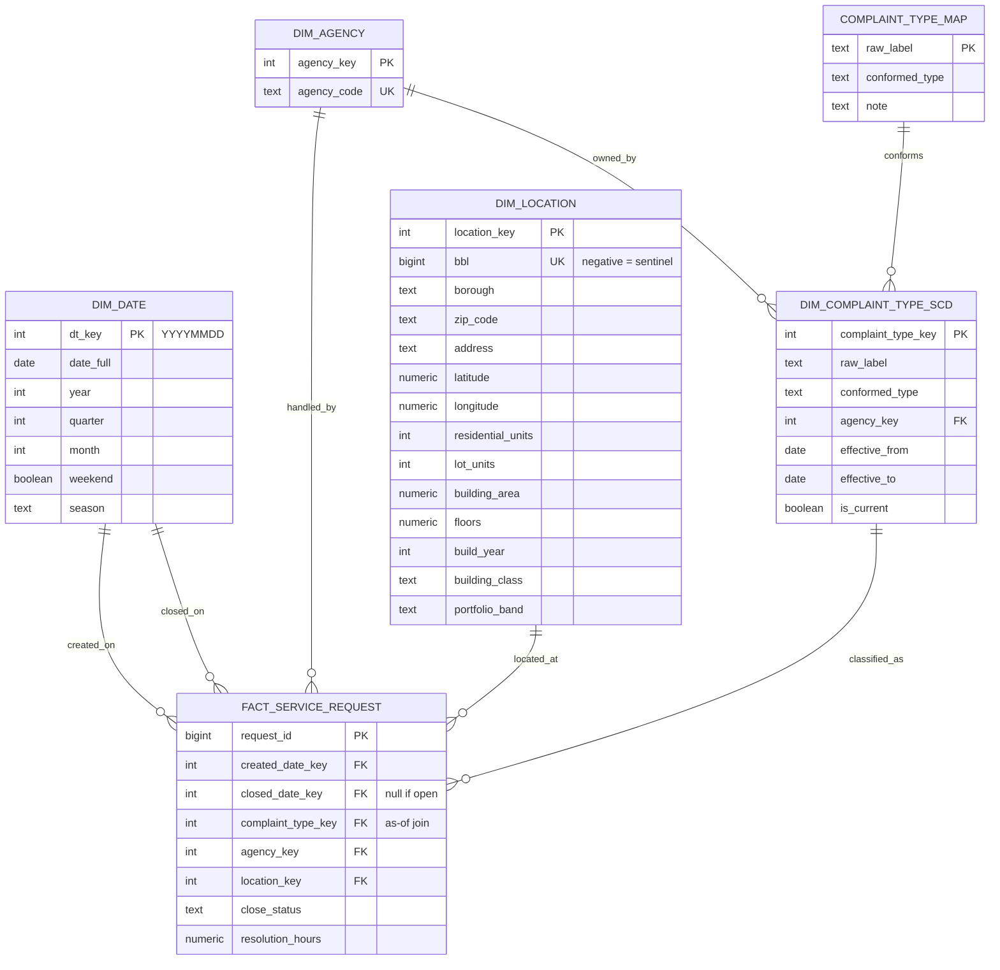

# NYC 311 Analytics Warehouse

A dimensional model built in PostgreSQL over NYC's 311 service request data,
designed so that all transformation happens in SQL and the BI tools consume
a governed layer rather than doing their own modeling.

15.8M service requests (2022–present), a Type 2 dimension tracking 16 years
of complaint-taxonomy drift, and building-level attributes joined from NYC's
tax lot dataset.

## Architecture

| Layer | Form | Purpose |
|-------|------|---------|
| `raw`  | tables | Landing zone. All columns TEXT — loader failures never block ingestion. |
| `stg`  | tables | Typed and cleaned. Casts, null handling, validity rules, derived measures. |
| `core` | tables | Dimensional model — fact table, four dimensions, SCD Type 2 complaint type. |
| `rpt`  | views  | Reporting views, flattened per dashboard. |
| `qa`   | tables | Data quality audits, retained as evidence rather than run-and-discard. |

Power BI imports the `core` star directly, since its engine is optimized for
star schemas. Tableau consumes flattened `rpt` views, since its extract engine
prefers wide tables. One governed SQL layer, consumed idiomatically by each tool.

## Schema

The complaint type dimension is joined with an **as-of range join** — each
request picks the dimension version in effect on its created date, not the
current one. Joining on `is_current` would silently rewrite history.

`dim_date` is a role-playing dimension, referenced twice (created and closed).
In Power BI the created-date relationship is active and the closed-date
relationship requires `USERELATIONSHIP`.

## Data sources

| Source | Grain | Rows | Purpose |
|---|---|---|---|
| 311 Service Requests (`erm2-nwe9`) | one request | 15.8M | Fact table, 2022–present |
| 311 taxonomy census (`erm2-nwe9`, `76ig-c548`) | type × agency × month | 36.5K | SCD2 source, 2010–present |
| PLUTO (`64uk-42ks`) | tax lot | ~860K | Building attributes and per-unit denominators |

## Table sizes

| Table | Rows |
|---|---|
| `raw.service_requests` | 15,833,079 |
| `stg.service_requests` | 15,833,079 |
| `stg.taxonomy_census` | 36,494 |
| `core.fact_service_request` | 15,833,079 |
| `core.dim_location` | 706,680 |
| `core.dim_complaint_type_scd` | 620 |
| `core.dim_date` | 1,826 |
| `core.dim_agency` | 36 |

## Data quality

The extract's `min`/`max` on `created_date` spanned 2022-01 to 2025-10 and
looked complete. Reconciling monthly row counts against independently
aggregated source counts showed it was complete only through 2024-06 — two
later months held ~0.5% slivers and the rest were absent. A few thousand
outlier rows made two years of missing data invisible to `min`/`max`. A
backfill brought the table to full monthly coverage. Before/after snapshots
are retained in `qa.extract_completeness`.

Findings on the merged extract:

- `unique_key` fully distinct — no ingestion duplication
- 13,072 rows (0.08%) have `closed_at` before `created_at`
- `closed_at` ranges from 1900 to 2033; `created_at` is bounded by the
  extract filter and is clean
- BBL populated on 88% of rows; BBL 0 is a geocoding-failure placeholder
  carrying 256 distinct addresses and 73 distinct ZIP codes, not a building
- The same BBL carries an average of 1.4 address spellings and 1.4
  coordinate pairs — spelling variance and geocoding jitter
- Roughly 60 complaint types dated June–July 2019 are automated security
  scanner payloads (path traversal, SQL injection, shell injection strings)
  submitted through the 311 web form and recorded as complaint types

## Taxonomy drift

Of 185 complaint types above 5,000 requests, only 72 span the full 2010–2026
window. 48 appear partway through, 43 stop before the end, and 22 both appear
and disappear — 61% churn, with 5M requests belonging to labels that no
longer exist.

The drift is **event-shaped rather than pairwise**. In September 2021 DSNY
replaced its entire 311 taxonomy at once: roughly ten labels retired while
thirteen new ones appeared, in a many-to-many restructure that cannot be
resolved into renames. Alongside that are genuine 1:1 renames
(`HEATING` → `HEAT/HOT WATER`, March 2014) and splits (`Bike Rack Condition`
became `Bike Rack`, `Bench`, `Leaning Bar`, and `Wayfinding`).

A separate cohort of complaint types tracks pandemic policy in near-real-time —
non-essential construction (March 2020), phased-reopening non-compliance
(June 2020 – July 2021), vaccine mandate non-compliance (August 2021). These
have no predecessor and no successor; their bounded effective ranges are the
finding, not a gap.

## Known gaps

- Seven requests (two complaint types, both created 2026-07-30) have no
  dimension row, because the types were created after the taxonomy census
  was extracted. These carry a NULL `complaint_type_key`.
- The trailing month exceeds 100% completeness in the audit because the
  census and fact extracts were pulled on different dates.
- `location_type` was not extracted, so the ~1.9M requests without a building
  cannot be separated into "not a building" and "geocoding failed".
- `COPY` statements carry absolute Windows paths and must be edited before
  running elsewhere.
- PLUTO is a manual browser download rather than a scripted extract.
- `complaint_type_map` is partial and hand-curated by design.

## Reproducing

1. Get a free app token from NYC Open Data (Developer Settings) and save it
   as `ingest/token.txt`.
2. `pip install requests`
3. `python ingest/extract_taxonomy.py` — monthly complaint type / agency
   counts, 2010–present.
4. `python ingest/extract_311.py` — row-level service requests, 2022–present.
5. Download PLUTO manually (see `ingest/PLUTO.md` for the URL).
6. Run the SQL in numbered order, editing the `COPY` paths first.